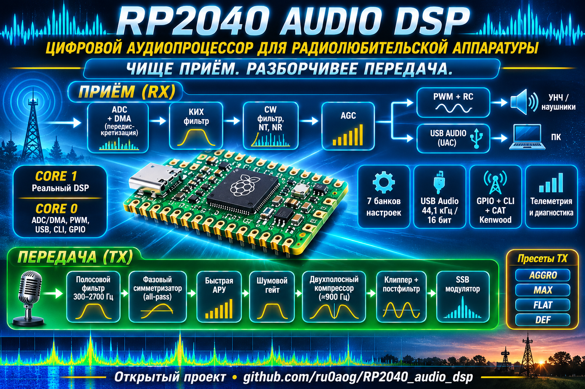
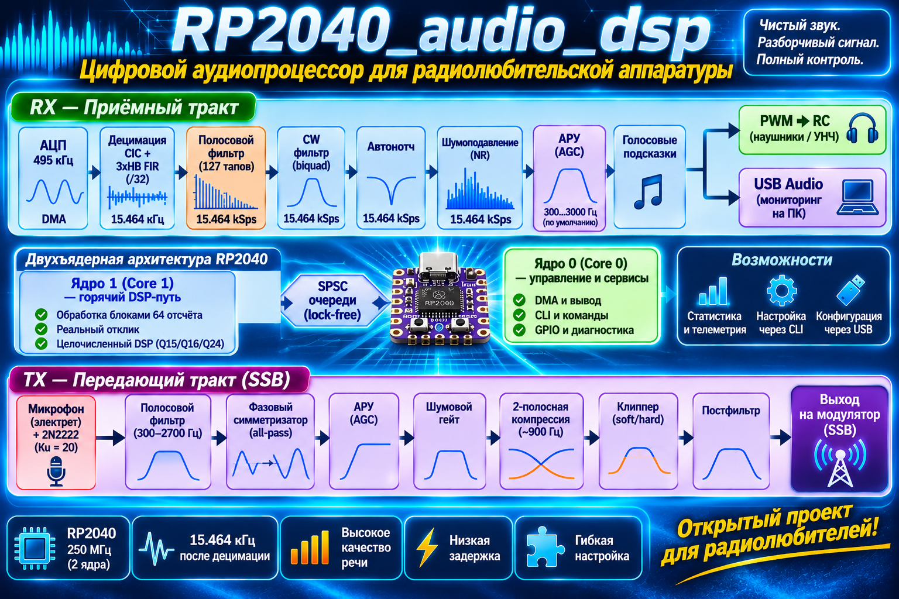
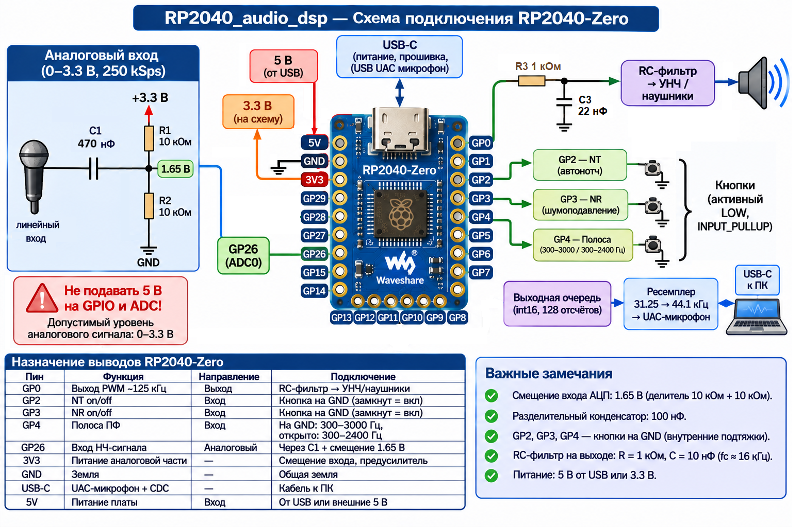

[](https://deepwiki.com/ru0aog/RP2040_audio_dsp)      
  
# RP2040_audio_dsp      
  
Двунаправленный НЧ аудио DSP-тракт радиостанции на Raspberry Pi Pico (RP2040):  
полный речевой процессор передачи (TX) и процессор приёма (RX) в одном устройстве.  
  
    
  
## Назначение  
  
Цифровой аудиопроцессор для радиолюбительской аппаратуры. Выполняет обработку  
звукового тракта приёмника и передатчика в реальном времени: фильтрацию,  
шумоподавление, автоматическую регулировку усиления и формирование «плотного»  
речевого сигнала для SSB-передачи. Встраивается в трансиверы, приёмники и  
самодельные радиостанции как законченный DSP-модуль между микрофоном/НЧ-трактом  
и модулятором/усилителем.  

   

## Описание

### Назначение каскадов приёмного тракта:
Захват АЦП и децимация (~495 кГц → ~15.464 кГц, коэффициент /32). Непрерывный сбор отсчётов через DMA, удаление постоянной составляющей (EMA) и четырёхступенчатое понижение частоты (CIC /2 и три каскада half-band FIR). Оверсэмплинг добавляет около 2.5 бита к эффективной разрядности АЦП (ENOB ~10–11 бит, динамический диапазон 60–70 дБ).
Полосовой FIR-фильтр (127 отводов, 300–3000 Гц). Симметричный линейно-фазовый фильтр основной селекции. Формирует крутые скаты АЧХ, подавляет внеполосные сигналы соседних станций и устраняет фазовые искажения в полосе пропускания.
Телеграфный CW-фильтр (3 биквада Q19 + шум). Узкополосный резонансный фильтр (полоса 80–500 Гц, центральная частота 300–3000 Гц) для выделения телеграфных посылок из эфирного шума. Дополнительно позволяет подмешивать мягкий фоновый шум, чтобы избежать утомляющего эффекта «звона» на сверхмалых полосах.
Автоматический режекторный фильтр — Автонотч (NLMS-предиктор). Адаптивный фильтр с нормализованным алгоритмом наименьших квадратов. Обнаруживает и вырезает узкополосные тональные помехи (свисты гетеродинов, несущие настройки, наводку USB 1 кГц), не затрагивая основной спектр речи.
Цифровое шумоподавление — NR (LMS ALE). Адаптивный линейный предсказатель (Adaptive Line Enhancer), разделяющий коррелированный полезный сигнал и некоррелированный белый шум эфира. Очищает слабые речевые и телеграфные сигналы в условиях высокого уровня атмосферных и индустриальных помех.
АРУ + Лимитер (профили Речь / CW). Двухрежимная автоматическая регулировка усиления с защитным ограничителем пиков. Удерживает комфортную громкость при замираниях (QSB) и резких перепадах уровней станций, а при отключении переходит в режим ручного усиления (0..400%).
Подмес голосовых клипов и разветвление (Fan-out). После АРУ в тракт подмешиваются PCM-подсказки (номер банка, режимы работы), после чего поток через SPSC-очереди одновременно подаётся на ШИМ-выход (GP1, 125 кГц с noise shaping) для наушников/УНЧ и в USB Audio (44.1 кГц / 16 бит) для записи и цифровых видов связи на ПК.
  
### Назначение каскадов передающего тракта:
Входной полосовой FIR (300–2700 Гц, 127 отводов). Срезает низкочастотную энергию (основной тон и задувание в микрофон ниже 300 Гц) до детекторов автоматики. Это не даёт басам ложно сбрасывать усиление тракта и «проваливать» среднечастотный спектр.
Фазовый симметризатор (All-Pass ротатор). Устраняет природную асимметрию пиков голоса (разницу в 3–6 дБ между положительной и отрицательной полуволнами) без изменения АЧХ. Выравнивание амплитуд позволяет поднять раскачку клиппера на 2–3 дБ без роста искажений.
Быстрая АРУ + Нойз-гейт (порог + полка −24 дБ). АРУ удерживает стабильную рабочую точку перед компрессором независимо от расстояния до микрофона. Гейт в паузах речи снижает усиление до −24 дБ (вместо полного глушения «в ноль»), подавляя шум вентиляторов без эффекта «мёртвых пауз» и щелчков при открытии.
Двухполосный компрессор (раздел ≈ 900 Гц). Независимо сжимает НЧ-полосу (гласные, медленное восстановление) и ВЧ-полосу (согласные, быстрое восстановление). Исключает эффект «накачки» (pumping), при котором громкие гласные подавляют тихие шипящие и взрывные согласные.
Мягкий клиппер + Пост-FIR (300–2700 Гц). Безынерционный ограничитель срезает короткие транзиентные пики (1–3 мс), поднимая соотношение средней мощности к пиковой (RMS/Peak) до 6–8 дБ. Повторный полосовой FIR-фильтр на выходе полностью подавляет гармоники клиппирования выше верхней границы полосы, сохраняя чистый спектр передатчика.


## Аппаратная платформа  
  
Ядро — RP2040: два ядра Cortex-M0+ на 250 МГц (разгон со штатных 133 МГц),  
264 КБ RAM, встроенный 12-битный АЦП. Весь горячий путь — целочисленная  
арифметика Q15/int64 без float; горячие функции помечены `__not_in_flash_func`.  
  
Вход — встроенный АЦП (GP27/ADC1) с оверсэмплингом ~495 ksps и децимацией /32  
до ~15.464 ksps: эффективная разрядность ~10–11 бит, динамический диапазон  
60–70 дБ — достаточно для телефонной полосы 300–3000 Гц.  
  
Выходы — два параллельных: PWM на GP1 (несущая ~125 кГц, 10 бит + noise shaping  
первого порядка — чистая тишина без ступенек квантования) и USB Audio Class  
(UAC-микрофон 44100/16) для мониторинга и записи на ПК.  
  
## Архитектура  
  
Двухъядерная: Core 1 целиком отдан DSP-тракту в реальном времени, Core 0  
обслуживает DMA-захват АЦП, выдачу в PWM и USB, CLI, GPIO-управление и  
диагностику. Захват — два DMA-канала с аппаратным `chain_to`: напарник  
стартует в момент завершения блока, мёртвого времени нет. Межъядерный обмен —  
lock-free SPSC-очереди int16-блоков.  
  
Запуск синхронизирован: Core 1 ждёт флаг `core0_ready` (таймаут 10 с).  
Порядок USB критичен: `af_usb_init()` вызывается ДО `Serial.begin()`  
(UAC-дескрипторы регистрируются до энумерации, CDC — последним).  
  
## Тракт приёма (RX)  
  
ADC1 (GP27, ~495 ksps, DMA, два канала с chain_to)
-> центрирование DC (EMA k=1/256)
-> CIC-дециматор /2 (N=3)
-> half-band FIR /2 (31 отвод)
-> half-band FIR /2 (15 отводов)
-> half-band FIR /2 (15 отводов) = ~15.464 ksps
-> полосовой FIR 127 отводов, симметричный (300..3000 Гц, настраивается)
-> CW-режим: 3 биквада Q19 + аддитивный шум (вкл/выкл)
-> автонотч NT (NLMS-предиктор, вкл/выкл)
-> шумоподавление NR (LMS ALE, вкл/выкл)
-> АРУ + лимитер (два профиля: речь / CW; off -> ручное усиление 0..400%)
-> подмес голосовых клипов (af_voice, после АРУ)
-> fan-out: две SPSC-очереди int16-блоков
-> PWM на GP1 (основной выход, отключаемый — pwm off глушит несущую)
-> UAC-микрофон 44100/16 (всегда включён)

  
## Тракт передачи (TX) — речевой процессор  
  
Активируется по PTT (GP8, LOW=TX). Цепочка на ~15.464 ksps:  
  
y -> полосовой FIR (tx_lo..tx_hi, 127 тапов, Q15)
-> all-pass симметризатор (phase rotator, a=0.5 -> ~90° на 1 кГц;
выравнивает пик-фактор речи, клиппер работает эффективнее)
-> АРУ (EMA-огибающая agc_env, gain = target/env, только усиливает:
gain >= 1, потолок AF_TX_AGC_MAX_X10=20x; при env < txgate gain
клампится к 1 — не разгоняет шум пауз)
-> шумовой гейт (общая огибающая с АРУ; нижняя ступень gfloor
регулируется 0..65536 Q16: 4120 = -24 дБ, 0 = полная тишина)
-> 2-полосная компрессия (комплементарный split ~900 Гц: lo = IIR-НЧ,
hi = x - lo; раздельные EMA-огибающие и пороги — согласные не
давятся гласными; off -> однополосный компрессор)
-> клиппер: soft (кубический y = x - x^3/(3t^2), нормирован к t)
или hard (жёсткий) — переключается txmode
-> постфильтр (тот же FIR — срезает гармоники клиппинга выше tx_hi)
-> makeup-gain -> int16

  
Цель — «плотный» речевой сигнал: компрессия поднимает среднюю мощность,  
клиппер добавляет ещё ~4–6 дБ, постфильтр убирает гармоники — эфир не  
грязнится. Проверено на голосе: RMS/Peak ~6–8 дБ при пресете aggro.  
  
### Пресеты TX (команда `txpreset`)  
  
- `aggro` — агрессивный «кирпич»: band 300–2700, comp 8:1, clip 8192,  
  2band on, mode soft.  
- `max` — максимум плотности: band 300–2200, comp 10:1, clip 4096.  
- `flat` — линейный тракт: comp 1:1, clip 32767, gate 0, 2band off  
  (для отладки и измерений).  
- `def` — заводские дефолты из `af_config.h`.  
  
## Управление  
  
Три параллельных канала: Serial CLI (115200), Kenwood-подобные CAT-команды  
(по `;`), GPIO-тумблеры. Команда действует сразу; при следующем переключении  
пина GPIO-контур перезапишет настройку.  
  
Настройки сохраняются в 7 банках во flash (EEPROM-эмуляция, версионирование,  
park-механизм: во время записи DSP ставится на паузу). Выбор банка — 3-битным  
кодом на GP2–GP4. Голосовое сопровождение событий — PCM-клипы из flash,  
подмешиваются в выход.  
  
## Подключение  
  
  
  
| Сигнал        | GPIO | Примечание                                                      |  
|---------------|------|-----------------------------------------------------------------|  
| Вход НЧ       | GP27 | ADC1, через разделительный конденсатор + смещение к Vref/2      |  
| Выход PWM     | GP1  | RC-фильтр 2 каскада -> УНЧ / модулятор                          |  
| Банк bit0     | GP2  | селектор банка, 3 бита (LOW=1): 000=ручной, 001..111=банки 1..7 |  
| Банк bit1     | GP3  | то же                                                           |  
| Банк bit2     | GP4  | то же                                                           |  
| NR on/off     | GP5  | замкнуть на GND -> шумоподавление (INPUT_PULLUP)                |  
| NT on/off     | GP6  | замкнуть на GND -> автонотч (INPUT_PULLUP)                      |  
| Bypass on/off | GP7  | замкнуть на GND -> обход: выход = вход (INPUT_PULLUP)           |  
| PTT           | GP8  | замкнуть на GND -> TX (передача), open -> RX                    |  
| USB           | —    | UAC-микрофон 44100/16 + CDC (Serial CLI)                        |  
  
Несущая PWM ~125 кГц, темп обновления duty — ~15.464 кГц. Разделительный  
конденсатор на выходе: 0.47–1 мкФ для линейного входа ≥10 кОм.  
  
### Микрофонный вход  
  
Электретный капсуль требует смещения и предусилителя. Минимальная схема на  
одном 2N2222 (коллекторная ООС, эмиттер на земле): Ku ~20, рабочая точка  
~1.6 В. Речь 10–30 мВ -> 0.2–0.6 В на GP27 — середина диапазона АРУ.  
Готовая альтернатива — модуль MAX9814 (усиление до 60 дБ + встроенная АРУ).  
После сборки подобрать `txgate` под шум помещения.  
  
## Serial CLI (115200)  
```
--- RX ---
band — полоса ПФ в Гц
nt on|off — автонотч
nr on|off — шумоподавление (взаимоисключает с NT)
cw on|off — телеграфный фильтр
cw freq — центральная частота CW (300..3000)
cw bw — полоса CW (80..500)
cw noise <0..2000>— примесь шума в CW
agc on|off — АРУ (off -> ручное усиление, лимитер остаётся)
gain <0..400> — ручное усиление при agc off, %
bypass on|off — обход: выход = вход

--- TX ---
tx on|off — режим передачи (дублирует PTT GP8)
txband — полоса TX-фильтра (300..2700 по умолч.)
txcomp — компрессия x10 (10=1:1 off, 100=10:1 лимитер)
txclip — порог клиппера (4096..32767)
txagc — целевой уровень АРУ (4096..32767)
txgate — порог шумового гейта (0 = off)
txgfloor <0..65536> — нижняя ступень гейта Q16 (4120=-24дБ, 0=тишина)
txap on|off — all-pass симметризатор
txmode soft|hard — кубический / жёсткий клиппер
tx2band on|off — 2-полосная компрессия
txpreset <aggro|max|flat|def> — пресет одной командой

--- Общие ---
pwm on|off — PWM-выход (off = несущая заглушена, пин в 0)
voice [N] — проиграть клип N; voice vol <0..400> — громкость, %
save <1..7> — сохранить настройки в ячейку
load <0..7> — применить ячейку (0 = ручной режим)
banks — показать все ячейки
banks clr — заводские пресеты (ребут)
stats — диагностика
help — справка
```
Kenwood-подобные CAT-команды — по ;:
ID; -> ID019; FA; / FA00014074000; IF; -> IF...;
MD; / MD3; (CW) NT; / NT0; / NT1; NR; / NR0; / NR1;
SHxx; — верх полосы SLxx; — низ полосы TX; / RX;

  
## Структура проекта  
```
RP2040_audio_dsp/
├── platformio.ini # env:pico, Arduino-Pico, TinyUSB, arduino-audio-tools
├── RP2040_audio_dsp.cpp # setup/loop (Core 0), setup1/loop1 (Core 1)
└── src/
├── af_config.h # все константы: Fs, пины, параметры фильтров и TX
├── af_queue.h # header-only SPSC ring-buffer
├── af_capture.h/.cpp # ADC ~495 ksps + 2 DMA-канала chain_to, IRQ на Core 0
├── af_dsp.h/.cpp # децимация /32, ПФ, CW, NT, NR, АРУ, fan-out очередей
├── af_tx.h/.cpp # TX-тракт: all-pass, АРУ, гейт, 2-полосная компрессия,
│ # клиппер, пост-FIR
├── af_pwm.h/.cpp # PWM ~125 кГц + DMA pacing, 4 duty-буфера, noise shaping
├── af_usb.h/.cpp # UAC-микрофон 44100/16 (arduino-audio-tools)
├── af_cli.h/.cpp # Serial-команды + Kenwood CAT
├── af_gpio_ctl.h/.cpp# управление по GPIO: банки GP2-4, NR/NT/bypass/PTT
├── af_store.h/.cpp # 7 банков настроек во flash (версионирование)
├── af_led.h/.cpp # LED-индикация (цвет банка, вспышки событий)
├── af_voice.h/.cpp # голосовые сообщения: плеер на Core 1, очередь с Core 0
└── voice/ # Voice_0N.inc — PCM int16, генерирует WAV_convertor.py
```
  
## Сборка  
  
PlatformIO, ядро earlephilhower (Arduino-Pico):  
  
pio run -e pico
pio run -e pico -t upload

  
UAC-микрофон включён всегда; зависимость `arduino-audio-tools` обязательна.  
  
## Диагностика  
  
`stats` печатает:  
  
band=.. nt=.. nr=.. cw=.. agc=.. bypass=.. tx=..
tx: band=.. comp=.. clip=.. agc=.. gate=.. gfloor=.. ap=.. mode=.. 2band=..
core1_load=..% cap_dropped=N out_dropped=N clip=N
cap: isr=N fcs_over=N q_full=N scratch=N busy=N
pwm: on underruns=N fill=N
usb: mounted=1 dropped=N
core1: max_block_us=N
  
- `cap_dropped` — блоки ADC, потерянные из-за переполнения очереди  
- `out_dropped` — выходные блоки, не забранные потребителями  
- `clip` — срабатывания ограничителя int16  
- `pwm underruns` — опустошение PWM-буферов; `fill` — блоков в очереди  
- `max_block_us` — пиковое время обработки блока; бюджет ~4136 мкс.  
  В TX ~3600–3950 мкс (L1 ~82–88%), запас ~5–8%  
  
## Производительность  
  
- RX: L1 ~57–65%, max_block_us ~2400–2900 мкс.  
- TX (полный процессор): L1 ~82–88%, max_block_us ~3600–3950 мкс.  
- Кешированы `tx_depth_q15` и `tx_makeup_q15` (пересчёт в сеттерах,  
  не на отсчёт). Первый кандидат на разгрузку при новых фичах —  
  пост-FIR 63-тапный ФНЧ.  
  
## Известные ограничения  
  
- АРУ TX только усиливает (gain >= 1); ослабление громкого входа —  
  на компрессоре/клиппере.  
- При входе <50 мВ упор в `AF_TX_AGC_MAX_X10` (20x) — выход ниже цели.  
- `txagc 0` не отключает АРУ (кламп 4096).  
- Гейт делит огибающую с АРУ (`agc_env`).  
- `strncmp(cmd,"tx",2)` перехватывает любые команды на «tx*» — новые  
  tx-команды добавлять ПОСЛЕ существующих веток.  
- Спуры 1 кГц + гармоники на входе — USB SOF-шум, наводится на АЦП  
  по земле/питанию. Лечится разводкой или автонотчем.  
  
## Разрядность тракта: обоснование выбора  
  
#### Вход.  
Встроенный АЦП RP2040 даёт ENOB ≈ 8.5–9 бит. Децимация ~495 → 15.464 кс/с  
прибавляет ~2.5 бита за счёт усреднения шума квантования — итого ~10–11 бит,  
динамический диапазон 60–70 дБ. Для телефонной полосы 300–3000 Гц достаточно.  
  
#### Выход через UAC.  
Внутренний тракт 32/64-битный, на выходе ресемплинг в 16 бит х 44.1 кГц —  
с запасом покрывает входные ~10–11 бит.  
  
#### Выход через PWM.  
Несущая 125 кГц, разрешение 10 бит + noise shaping первого порядка: ошибка  
квантования вытесняется к несущей и подавляется RC-фильтром. В полосе  
0–4 кГц эффективное разрешение выше номинальных 10 бит — тишина чистая.  
  
#### Баланс системы.  
Вход ~10–11 бит, PWM 10 бит + error feedback, UAC 16 бит — конфигурация  
сбалансирована, узких мест нет.  
  
## Происхождение кода  
  
Портировано из проектов ru0aog:  
  
- `af_capture.cpp` — моно-версия `src/dsp/rx_capture.cpp` (RP2040_receiver)  
- `af_dsp.cpp` — CIC/HB-децимация, ПФ, NT, NR из `src/dsp/rx_dsp.cpp`,  
  АРУ из `src/audio/rx_audio.cpp` (RP2040_receiver)  
- `af_usb.cpp` — Фарроу-ресемплер, биквады, UAC из `src/rx/rx_usb_audio.cpp`  
  (RP2040_radiomodem)  
- `af_tx.cpp` — новый код (речевой процессор TX)  
- `af_pwm.cpp` — новый код (PWM+DMA вывода)  
- `af_gpio_ctl.cpp`, `af_store.cpp`, `af_led.cpp`, `af_voice.cpp` — новый код  
- Kenwood CAT-парсер — по образцу `src/cat/fldigi_cat.cpp` (RP2040_receiver)  
- Синхронизация запуска ядер (`core0_ready`) и порядок USB-инициализации —  
  по образцу RP2040_radiomodem  
  
Весь горячий путь — целочисленный Q15/int64, без float; горячие функции  
помечены `__not_in_flash_func`. Деления int64 в NT/NR заменены на  
нормировку по старшему биту (`__builtin_clzll` + сдвиг).  