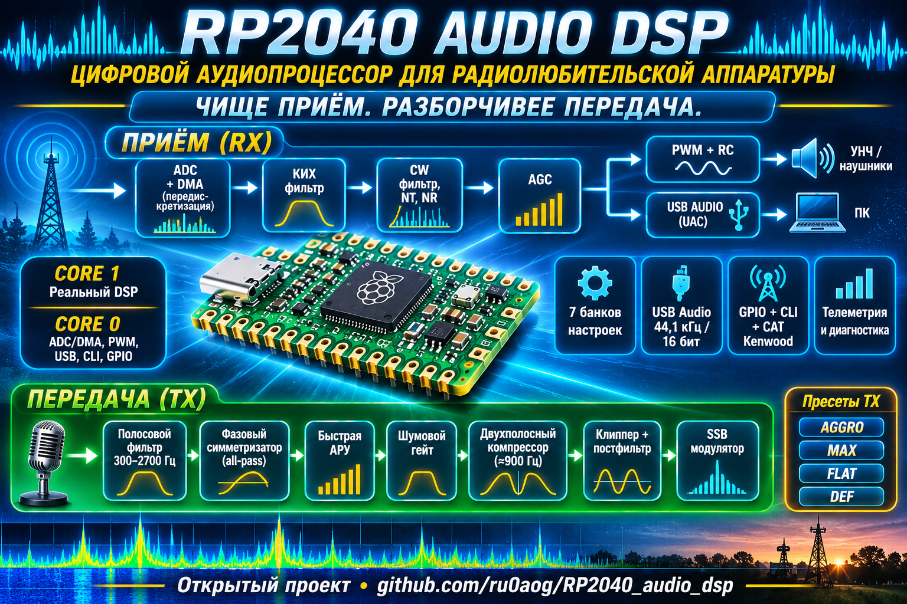
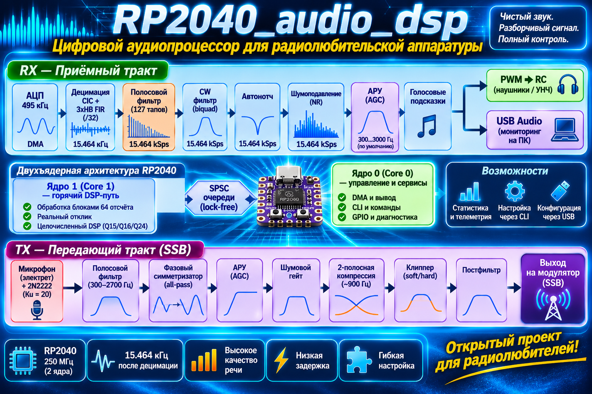
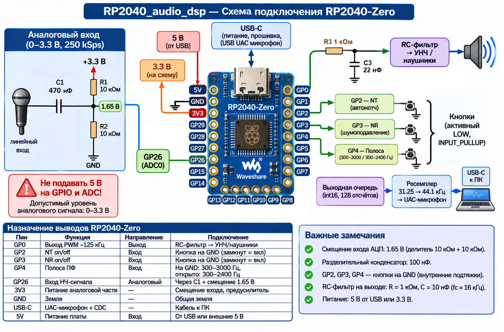

[](https://deepwiki.com/ru0aog/RP2040_audio_dsp)

# RP2040_audio_dsp

Цифровой аудиопроцессор для радиолюбительской аппаратуры на базе **Raspberry Pi Pico (RP2040)**: полный речевой процессор передачи (TX) и процессор приёма (RX), цифровой магнитофон, CW-маяк, RTTY-декодер и USB-диск для обмена файлами с ПК — в одном устройстве.



---

## Содержание

- [Назначение](#назначение)
- [Архитектура и аппаратная платформа](#архитектура-и-аппаратная-платформа)
- [Структура и блок-схемы трактов](#структура-и-блок-схемы-трактов)
  - [Приём (RX)](#приём-rx)
  - [Передача (TX) — речевой процессор](#передача-tx--речевой-процессор)
  - [Обоснование разрядности тракта](#обоснование-разрядности-тракта)
- [Подключение](#подключение)
- [Управление и интерфейсы](#управление-и-интерфейсы)
  - [Serial CLI (115200)](#serial-cli-115200)
  - [CAT-команды (Kenwood)](#cat-команды-kenwood)
- [Цифровой магнитофон и USB-диск (MSC)](#цифровой-магнитофон-и-usb-диск-msc)
- [CW-ключ, маяки и RTTY-декодер](#cw-ключ-маяки-и-rtty-декодер)
- [Сборка и структура проекта](#сборка-и-структура-проекта)
- [Диагностика и производительность](#диагностика-и-производительность)
- [Известные ограничения и происхождение кода](#известные-ограничения-и-происхождение-кода)

---

## Назначение

Выполняет обработку звукового тракта приёмника и передатчика в реальном времени: фильтрацию, шумоподавление, автоматическую регулировку усиления и формирование «плотного» речевого сигнала для SSB-передачи. Встраивается в трансиверы, приёмники и самодельные радиостанции как законченный DSP-модуль между микрофоном/НЧ-трактом и модулятором/усилителем.



---

## Архитектура и аппаратная платформа

- **Ядро:** RP2040 — два ядра Cortex-M0+ на частоте **320 МГц** (разгон), 264 КБ RAM, встроенный 12-битный АЦП. Весь горячий путь написан на целочисленной арифметике `Q15`/`int64` без `float`; критичные функции размещены в RAM (`__not_in_flash_func`).
- **Двухъядерное разделение:**
  - **Core 1** — DSP-тракт в реальном времени.
  - **Core 0** — DMA-захват АЦП, выдача в PWM и USB, CLI, GPIO, файловый менеджер, диагностика.
- **Ввод / Вывод:**
  - **Вход:** встроенный АЦП (`GP27`/ADC1) с оверсэмплингом ~495 kS/s и децимацией до ~15.464 kS/s. Захват ведут два DMA-канала с аппаратным `chain_to` (без мёртвого времени).
  - **Выходы:** PWM на `GP0` (несущая 125 кГц, 2560 уровней + noise shaping первого порядка) и USB Audio Class (UAC-микрофон 44100 Гц / 16 бит).
- **Синхронизация:** межъядерный обмен через lock-free SPSC-очереди `int16`-блоков. Core 1 ожидает флаг `core0_ready`. Порядок инициализации USB критичен: `af_usb_init()` вызывается строго **до** `Serial.begin()`.

---

## Структура и блок-схемы трактов

### Приём (RX)

```text
ADC1 (GP27, ~495 ksps, DMA, два канала с chain_to)
  -> центрирование DC (EMA)
  -> NB (импульсный blanker, до децимации)
  -> CIC-дециматор /2 -> half-band FIR /2 -> HB /2 -> HB /2 = ~15.464 ksps
  -> полосовой FIR 127 отводов (band lo..hi)
  -> CW-режим: биквады + аддитивный шум (вкл/выкл)
  -> автонотч NT (NLMS) -> шумоподавление NR (LMS ALE)
  -> АРУ + лимитер (off -> ручное усиление)
  -> подмес голосовых клипов и play-магнитофона
  -> fan-out: PWM на GP0 + UAC-микрофон 44100/16
```

- **Захват АЦП (~495 kS/s)** — непрерывный сбор отсчётов через DMA, удаление постоянной составляющей (EMA).
- **NB (Noise Blanker)** — импульсный подавитель до децимации: детектор `|x| > env·thr`, удержание последнего чистого отсчёта.
- **CIC/FIR фильтрация и децимация** — пятиступенчатое понижение частоты (два CIC и три каскада half-band FIR) до ~15.464 kS/s. Оверсэмплинг добавляет ~2.5 бита к ENOB АЦП (~10–11 бит, ДД 60–70 дБ).
- **Полосовой FIR** — 127 отводов, срезы задаются командами (по умолчанию 100–3100 Гц). Симметричный линейно-фазовый фильтр основной селекции.
- **Автоматический режекторный фильтр (NT)** — NLMS-предиктор, вырезает узкополосные тональные помехи (свисты гетеродинов, наводку USB 1 кГц).
- **Цифровое шумоподавление (NR)** — LMS ALE, разделяет коррелированный сигнал и некоррелированный шум.
- **CW-фильтр** — узкополосный резонансный фильтр (полоса 80–500 Гц, центр 300–3000 Гц) с опциональным подмесом фонового шума.
- **АРУ + Лимитер** — двухрежимная АРУ с ограничителем пиков; при `off` — ручное усиление `gain`.
- **Подмес и разветвление** — после АРУ подмешиваются PCM-подсказки и запись магнитофона; поток через SPSC-очереди идёт на PWM-выход и в USB Audio (44.1 кГц / 16 бит).

### Передача (TX) — речевой процессор

Активируется по `PTT` (`GP8`, `LOW=TX`) или командой `tx on`. При воспроизведении магнитофона в TX запись подставляется вместо микрофона (`af_rec_src`) и проходит весь процессор один раз, как живой сигнал.

```text
mic / af_rec_src -> полосовой FIR (txband) -> all-pass симметризатор
  -> АРУ (только усиливает, потолок ~20x) + шумовой гейт (полка txgfloor)
  -> 2-полосная компрессия (~900 Гц) или однополосная (tx2band off)
  -> клиппер soft (кубический) / hard (txmode)
  -> пост-FIR -> makeup-gain -> выход
```

- **Входной полосовой FIR (300–2700 Гц, 127 отводов)** — срез НЧ до детекторов автоматики.
- **Фазовый симметризатор (all-pass ротатор)** — выравнивает пик-фактор речи, повышая эффективность клиппера.
- **Быстрая АРУ + нойз-гейт** — стабильная рабочая точка перед компрессором; в паузах усиление снижается до полки `txgfloor` (−24 дБ по умолчанию), а не в ноль.
- **Двухполосный компрессор (раздел ~900 Гц)** — независимое сжатие НЧ и ВЧ, исключает эффект «накачки» (pumping).
- **Мягкий клиппер + пост-FIR** — кубический ограничитель поднимает соотношение RMS/Peak до 6–8 дБ; повторный FIR срезает гармоники клиппирования.

#### Пресеты TX (`txpreset`)

| Пресет | Описание |
|--------|----------|
| `aggro` | Агрессивный «кирпич»: `band 300–2700`, `comp 8:1`, `clip 8192` |
| `max` | Максимум плотности: `band 300–2200`, `comp 10:1`, `clip 4096` |
| `flat` | Линейный тракт (для отладки и измерений) |
| `def` | Заводские настройки по умолчанию из `af_config.h` |

### Обоснование разрядности тракта

- **Вход:** ENOB АЦП ~8.5–9 бит + децимация `~495 -> 15.464 кС/с` ≈ 10–11 бит (ДД 60–70 дБ) — достаточно для полосы 300–3000 Гц.
- **UAC:** внутренний тракт 32/64-бит, выход 16 бит × 44.1 кГц — с запасом.
- **PWM:** 2560 уровней (~11.3 бит) + noise shaping — ошибка квантования вытесняется к несущей 125 кГц и подавляется внешним RC-фильтром.

---

## Подключение



| Сигнал | GPIO | Примечание |
|--------|------|------------|
| **Вход НЧ** | `GP27` | ADC1, через разделительный конденсатор + смещение к `Vref/2` |
| **Выход PWM** | `GP0` | RC-фильтр -> УНЧ / модулятор |
| **Банк bit0..2** | `GP2–GP4` | Селектор банка (`LOW=1`): `000` = ручной, `001..111` = банки 1..7 |
| **NR on/off** | `GP5` | `LOW` -> шумоподавление |
| **NT on/off** | `GP6` | `LOW` -> автонотч |
| **Bypass** | `GP7` | `LOW` -> обход: выход = вход |
| **PTT** | `GP8` | `LOW` -> TX; при playback — выход управления PTT |
| **Rec** | `GP9` | `LOW` -> запись в слот (тракт -> TX, без активации PTT) |
| **Play** | `GP10` | `LOW` -> воспроизведение: CW.TXT-строка или голосовой слот |
| **Key dit/dah** | `GP11` / `GP12` | Ямбический / прямой телеграфный ключ |
| **Msg sel bit0/1** | `GP13` / `GP28` | Селектор сообщения `0..3` = слот/строка `1..4` |
| **OLED SDA/SCL** | `GP14` / `GP15` | Bit-bang I2C (вывод декодированного RTTY-текста) |
| **RGB LED** | `GP16` | WS2812 на RP2040-Zero (`GP23` — YD-RP2040, `GP25` — Pico) |
| **USB** | — | UAC-микрофон + MSC-диск + CDC (Serial CLI) |

> **Примечания по аналоговой части:**
> - Несущая PWM — 125 кГц, темп обновления duty ~15.464 кГц. Разделительный конденсатор на выходе: **0.47–1 мкФ** для линейного входа ≥ 10 кОм.
> - Электретный микрофонный капсюль требует фантомного смещения и предусилителя (минимальная схема на 2N2222 с $K_u pprox 20$ или модуль MAX9814). После сборки подберите порог `txgate` под шум помещения.

---

## Управление и интерфейсы

Доступны три параллельных канала управления: **Serial CLI (115200)**, **Kenwood-подобные CAT-команды** и **GPIO-тумблеры**. Любая программная команда действует немедленно; при следующем переключении физического пина GPIO-контур перезапишет соответствующую настройку.

Настройки сохраняются в **7 банков во flash** (последний сектор `0x1FF000`, версионирование, park-механизм: на время записи DSP ставится на паузу). Выбор банка задаётся 3-битным кодом на `GP2–GP4` (`000` = ручной режим). События сопровождаются голосовыми PCM-подсказками из flash.

### Serial CLI (115200)

```text
--- RX ---
band <lo> <hi>               — полоса ПФ в Гц
nt on|off                    — автонотч
nr on|off                    — шумоподавление (взаимоисключает с NT)
nb on|off / nb thr <val>     — импульсный blanker и его порог
cw on|off                    — телеграфный фильтр
cw freq / cw bw / cw noise   — частота, полоса и подмес шума в CW
cw key <0..3>                — ключ: 0=off / 1=iambic A / 2=iambic B / 3=straight
agc on|off                   — АРУ (off -> ручное усиление)
gain <0..400>                — ручное усиление при agc off, %
bypass on|off                — обход: выход = вход

--- TX ---
tx on|off                    — режим передачи (дублирует PTT GP8)
txband / txcomp / txclip     — полоса, компрессия и клиппер TX
txagc / txgate / txgfloor    — АРУ, порог и полка шумового гейта TX
txap on|off                  — all-pass симметризатор
txmode soft|hard             — режим клиппера
tx2band on|off               — 2-полосная компрессия
txpreset <aggro|max|flat|def>— применить пресет одной командой

--- Магнитофон ---
rec / stop                   — запись в слот активного сообщения (GP13/GP28)
play / stop                  — воспроизведение слота
recs                         — состояние слотов
rece                         — очистка всех слотов

--- Маяки ---
beacon <текст> <период с>    — CW-маяк (0 = off)
vbcn <период с>              — голосовой маяк (0 = off)

--- RTTY ---
rtty on|off                  — RTTY-декодер (взаимоисключает CW)
rtty scan on|off             — автосканер пары тонов
rtty ctr <Гц>                — ручной центр -> TRACK; 0 = назад в скан
rtty rev on|off              — инверсия mark/space
rtty sql <0..1>              — сквелч (дефолт 0.15)
rtty dbg on|off              — диагностика в Serial

--- Общие ---
pwm on|off                   — PWM-выход
voice [N] / voice vol <0..400> — голосовые клипы и громкость, %
save <1..7> / load <0..7>    — сохранить / загрузить банк настроек
banks / banks clr            — показать все ячейки / сбросить к заводским пресетам
fmap / ftest                 — карта flash / тестовый сектор
params dump                  — дамп параметров (для tools/af_panel.py)
version / stats / help       — версия прошивки, статистика, справка
```

### CAT-команды (Kenwood)

Поддерживаются базовые команды с терминатором `;`:

```text
ID; FA; IF; MD; NT; NR; SHxx; SLxx; TX; RX;
```

---

## Цифровой магнитофон и USB-диск (MSC)

### Цифровой магнитофон

4 слота во flash по 224 КБ (регион `0x11E000..0x1FDFFF`), соответствующие селектору `GP13`/`GP28`:

- **Запись (`rec` или `GP9`):** источник — активный тракт после всех обработок (RX — эфир, TX — микрофон). Кодирование **IMA-ADPCM** на лету в `af_rec_push`: децимация ×2 (`15464 -> 7732 Гц`), нибблы в RAM-буфер 112 КБ = 224 000 отсчётов (**≈ 29 с**). По команде `stop` происходит сброс во flash через flash-окно (~2.5–3 с мьюта).
- **Воспроизведение (`play` или `GP10`):** чтение слота из XIP, декодирование ADPCM + интерполяция ×2. В RX — подмес в выход; в TX — замещение микрофона + активация PTT на `GP8`.
- **Служебное:** пустой слот воспроизводит клип-заглушку `voice_14` (заливается автоматически при старте). Команды `rece` и `banks clr` очищают слоты. Формат слота `ver 0x02` (`codec 0 = PCM16`, `codec 1 = IMA-ADPCM`); заголовок валидируется при каждом чтении — битый слот считается пустым.

### USB-диск (MSC)

При подключении к ПК устройство монтируется как флеш-накопитель **10 МБ (FAT16)**. В RAM хранится только минимальный образ (~10 КБ: boot + root dir + `SET.TXT` + `CW.TXT`); таблица FAT (80 секторов) и WAV-данные синтезируются на лету в `af_fm_msc_read`.

**Раскладка LBA:** `0` boot, `1..80` FAT, `81` root dir, `82..97` `SET.TXT`, `98` `CW.TXT`, `99..` `REC1..REC4.WAV` (по 876 кластеров), `3603..` свободный пул (~8.4 МБ).

- **`SET.TXT`** — таблица банков (аналогична выводу `banks`). Редактируется прямо на диске: после сохранения файла (~800 мс дебаунса) парсер применяет изменения и записывает банки во flash.
- **`CW.TXT`** — 4 строки вызовов магнитофона. Непустая строка задаёт CW-посылку при нажатии `Play`; пустая строка означает воспроизведение голосового слота.
- **`REC1..REC4.WAV`** — записи магнитофона (PCM mono). ADPCM-слоты экспортируются 1:1 на 7732 Гц, legacy PCM-слоты — с ресемплингом в 8000 Гц. Пустой слот отображается как файл размером 44 Б (только заголовок).

**Загрузка файлов (Аплоад):**
Перезапись `RECn.WAV` на диске (копирование с заменой) конвертирует файл в слот `n`. Принимается **WAV PCM 8/16/24/32 бит, mono/stereo, любой частоты дискретизации** (автоматический ресемплинг в 7732 Гц) длительностью до ~29 с. Кодирование в ADPCM идёт инкрементально в `ul_push`, коммит во flash выполняется через ~1.5 с тишины после последнего сектора.

> Записи хоста в boot/FAT игнорируются (FAT read-only); системные папки ОС (`System Volume Information` и т. п.) помечаются удалёнными — `chkdsk` проходит без ошибок. После правки файлов обновите окно проводника (`F5`).

---

## CW-ключ, маяки и RTTY-декодер

- **Ямбический ключ:** входы `GP11` (`dit`) / `GP12` (`dah`), режимы `cw key`: `0=off`, `1=iambic A`, `2=iambic B`, `3=straight`. Тон самоконтроля 1000 Гц, управление PTT на `GP8`.
- **Маяки:**
  - **CW-маяк (`beacon`):** циклическая передача заданного текста по таймеру.
  - **Голосовой маяк (`vbcn`):** воспроизведение слота текущего банка по таймеру (отсчёт периода от конца передачи). CW- и голосовой маяки взаимоисключающие.
- **RTTY-декодер:** скорость **45.45 бод**, сдвиг **170 Гц** (кодировки Baudot ITA-2 + МТК-2, вывод кириллицы в UTF-8). Автопоиск пары тонов сканером Гёрцеля и АПЧ (AFC) по фазовой ошибке. Декодированный текст выводится в Serial и на I2C OLED-дисплей (`GP14`/`GP15`). Мьютируется по PTT и bypass; параметры сохраняются в банках (кроме `rtty ctr`). RSID-декодер исключён из сборки для экономии ~50 КБ RAM.

---

## Сборка и структура проекта

### Сборка

Используется **PlatformIO**, ядро `earlephilhower` (Arduino-Pico) и стек TinyUSB. UAC-микрофон и MSC-диск активны постоянно; библиотека `arduino-audio-tools` обязательна.

```bash
pio run -e pico
pio run -e pico -t upload
```

### Структура каталогов

```text
RP2040_audio_dsp/
├── platformio.ini          # env:pico, earlephilhower core, TinyUSB, arduino-audio-tools
├── RP2040_audio_dsp.cpp    # setup/loop (Core 0), setup1/loop1 (Core 1)
└── src/
    ├── af_config.h         # все константы: Fs, пины, параметры фильтров и TX
    ├── af_queue.h          # header-only SPSC ring-buffer
    ├── af_capture.*        # ADC ~495 ksps + 2 DMA-канала chain_to
    ├── af_dsp.*            # децимация, ПФ, CW, NT, NR, NB, АРУ, fan-out
    ├── af_tx.*             # TX-тракт: all-pass, АРУ, гейт, компрессия, клиппер
    ├── af_pwm.*            # PWM 125 кГц + DMA pacing, noise shaping
    ├── af_usb.*            # UAC-микрофон + MSC (usb_msc колбэки -> af_fm)
    ├── af_fm.*             # FAT16-диск 10 МБ: SET.TXT/CW.TXT парсеры, WAV-экспорт/аплоад
    ├── af_rec.*            # магнитофон: 4 слота × 224 КБ, IMA-ADPCM ~29 с
    ├── af_cli.*            # Serial-команды + Kenwood CAT + params dump
    ├── af_gpio_ctl.*       # GPIO: банки, NR/NT/bypass/PTT/rec/play, ямбик, маяки
    ├── af_store.*          # 7 банков настроек во flash + flash-окно
    ├── af_led.*            # LED-индикация (цвет банка, вспышки)
    ├── af_voice.*          # голосовые сообщения: плеер на Core 1
    ├── af_snr.*            # SNR-метрика
    ├── modes/              # RTTY-декодер, CW-телеграф (cwtx)
    └── voice/              # Voice_0N.inc — PCM int16 (WAV_convertor.py)
```

---

## Диагностика и производительность

Команда `stats` выводит состояние RX/TX, загрузку ядер, счётчики очередей, карту flash и геометрию USB-диска:

```text
fm: fat=80 dir=81 data=82 wav_cl=876 free=3603 total=20480 maxsamp=224002
```

- `cap_dropped` / `out_dropped` — потери блоков в очередях (в норме должны быть `0`).
- `max_block_us` — пиковое время обработки блока (общий бюджет ~4136 мкс).
- `fmap` — карта flash: прошивка, слоты магнитофона (`DATA`/`empty`), банки настроек.

**Типовая загрузка Core 1:**
- **RX:** ~57–65%, `max_block_us` ~2400–2900 мкс.
- **TX (полный речевой процессор):** ~82–88%, `max_block_us` ~3600–3950 мкс.
- **Запись слота во flash:** окно ~2.5–3 с (стирание 56 секторов + запись) — DSP ставится на паузу, XIP-доступ к слотам в это время заблокирован (`af_rec_flash_busy()`).

---

## Известные ограничения и происхождение кода

### Ограничения
- АРУ TX работает только на усиление (`gain ≥ 1`); ослабление обеспечивается компрессором и клиппером.
- Длительность записи и загрузки ограничена RAM-буфером (~29 с), хотя физический размер слота вмещает ~59 с ADPCM (задел для будущей потоковой записи).
- Параллельная запись двух `REC`-файлов с ПК не поддерживается.
- Спуры 1 кГц и их гармоники на входе вызваны USB SOF-шумом; устраняются правильной разводкой земли/питания или включением автонотча (`nt on`).
- В парсере CLI проверка `strncmp(cmd, "tx", 2)` перехватывает любые команды на `tx*` — новые TX-команды необходимо добавлять **после** существующих веток.

### Происхождение кода
Проект портирован и развит на базе наработок **ru0aog**:
- `af_capture.cpp` — моно-версия `src/dsp/rx_capture.cpp` (`RP2040_receiver`)
- `af_dsp.cpp` — CIC/HB-децимация, ПФ, NT, NR, АРУ (`RP2040_receiver`)
- `af_usb.cpp` — Фарроу-ресемплер, биквады, UAC (`RP2040_radiomodem`)
- Kenwood CAT-парсер — по образцу `src/cat/fldigi_cat.cpp` (`RP2040_receiver`)
- `af_tx.cpp`, `af_pwm.cpp`, `af_fm.cpp`, `af_rec.cpp`, `af_gpio_ctl.cpp`, `af_store.cpp`, `af_led.cpp`, `af_voice.cpp` — оригинальный код проекта.
