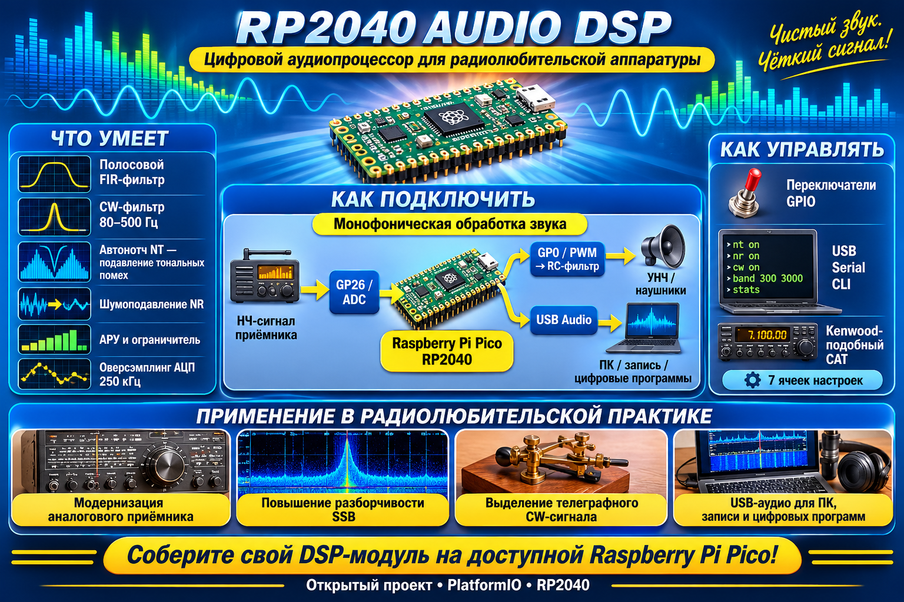

[](https://deepwiki.com/ru0aog/RP2040_audio_dsp)    
  
# RP2040_audio_dsp    

Моноканальный НЧ аудио DSP-тракт радиостанции на Raspberry Pi Pico (RP2040).  

  
  
Оцифровка звука встроенным АЦП с оверсэмплингом и децимацией, полосовая    
фильтрация, автонотч (подавление тональников), шумоподавление, АРУ —    
и вывод на GPIO через PWM и USB Audio (UAC-микрофон 44100/16).    
  
Управление функциями — замыканием пинов на GND, через Serial CLI    
и Kenwood-подобные CAT-команды.    
  
  

## Тракт обработки
```
ADC0 (GP26, 250 ksps, DMA, два канала с chain_to)
-> центрирование DC (EMA k=1/256)
-> CIC-дециматор /2 (N=3)
-> half-band FIR /2 (31 отвод)
-> half-band FIR /2 (15 отводов)
-> half-band FIR /2 (15 отводов) = 15.625 ksps
-> полосовой FIR 127 отводов, симметричный (300..3000 Гц, настраивается)
-> CW-режим: 3 биквада Q19 + аддитивный шум (вкл/выкл)
-> автонотч NT (NLMS-предиктор, вкл/выкл)
-> шумоподавление NR (LMS ALE, вкл/выкл)
-> АРУ + лимитер (два профиля: речь / CW)
-> fan-out: две SPSC-очереди int16-блоков
-> PWM на GPIO (основной выход)
-> UAC-микрофон 44100/16 (всегда включён)
```
Оверсэмплинг 250 ksps с децимацией /16 улучшает SNR встроенного АЦП    
(~12 дБ теоретически) и отсекает шум вне полосы.    
  
## Распределение по ядрам    
  
| Ядро   | Задачи                                                              |    
|--------|---------------------------------------------------------------------|    
| Core 1 | `af_dsp_poll` — весь DSP-тракт, real-time                           |    
| Core 0 | `af_capture` (DMA_IRQ_0) + `af_pwm_poll` + `af_usb_poll` + `af_cli_poll` + `af_gpio_ctl_poll` + диагностика |    
  
Захват: два DMA-канала (A/B) с аппаратным `chain_to` — напарник    
стартует в момент завершения блока, мёртвого времени на перезапуск нет.    
IRQ захвата живёт на Core 0, чтобы не конкурировать с DSP за Core 1.    
  
Запуск синхронизирован: Core 1 в `setup1()` ждёт флаг `core0_ready`    
(таймаут 10 с) — Core 0 взводит его после поднятия USB и завершения    
инициализации. Порядок USB критичен: `af_usb_init()` вызывается ДО    
`Serial.begin()` (UAC-дескрипторы регистрируются до энумерации, CDC —    
последним), иначе «USB-устройство не опознано» / зависание.    
  
## Структура проекта
```
RP2040_audio_dsp/
├── platformio.ini # env:pico, Arduino-Pico, TinyUSB, arduino-audio-tools
├── RP2040_audio_dsp.cpp # setup/loop (Core 0), setup1/loop1 (Core 1)
└── src/
├── af_config.h # все константы: Fs, пины, параметры фильтров
├── af_queue.h # header-only SPSC ring-buffer
├── af_capture.h/.cpp # ADC 250 ksps + 2 DMA-канала chain_to, IRQ на Core 0
├── af_dsp.h/.cpp # децимация /16, ПФ, CW, NT, NR, АРУ, fan-out очередей
├── af_pwm.h/.cpp # PWM ~125 кГц + DMA pacing 15.625 ksps, 4 duty-буфера
├── af_usb.h/.cpp # UAC-микрофон 44100/16 (arduino-audio-tools)
├── af_cli.h/.cpp # Serial-команды + Kenwood CAT
└── af_gpio_ctl.h/.cpp # управление функциями по GPIO, дебаунс
```
## Подключение    
  
    
  
| Сигнал        | GPIO | Примечание                                                  |    
|---------------|------|-------------------------------------------------------------|    
| Вход НЧ       | GP26 | ADC0, через разделительный конденсатор + смещение к Vref/2    |    
| Выход PWM     | GP0  | RC-фильтр 2 каскада (напр. 2× 1к/22нФ, fc~7 кГц) -> УНЧ       |    
| NT on/off     | GP2  | замкнуть на GND -> автонотч включён (INPUT_PULLUP)            |    
| NR on/off     | GP3  | замкнуть на GND -> шумоподавление включено (INPUT_PULLUP)     |    
| Полоса ПФ     | GP4  | GND -> 300..3000 Гц, разомкнут -> 300..2400 Гц (INPUT_PULLUP) |    
| USB           | —    | UAC-микрофон 44100/16 + CDC (Serial CLI)                      |    
  
Несущая PWM ~125 кГц (220 МГц / (wrap 999+1) / div 1.76), темп обновления    
duty — 15.625 кГц. Разделительный конденсатор на выходе: 0.47–1 мкФ    
для линейного входа ≥10 кОм.    
  
Пины и пресеты полосы меняются в `af_config.h` (`AF_PIN_*`, `AF_BAND_*`).    
Дебаунс ~40 мс (`AF_GPIO_POLL_MS`, `AF_GPIO_STABLE`).    
  
## Serial CLI (115200)  
  
Обычные команды — по переводу строки:
```
band — полоса ПФ в Гц (напр. band 300 3000)
nt on|off — автонотч (подавление тональников)
nr on|off — шумоподавление
cw on|off — CW-режим (биквады + медленный левелинг АРУ)
cw f0 — центральная частота CW-фильтра
cw bw — полоса CW-фильтра
cw noise <%> — уровень аддитивного шума
stats — диагностика: загрузка ядер, потери, клипы, max_block_us
help — справка

Kenwood-подобные CAT-команды — по `;` (совместимы с приёмником):
ID; -> ID019; FA; / FA00014074000; IF; -> IF...;
MD; / MD3; (CW) NT; / NT0; / NT1; NR; / NR0; / NR1;
SHxx; — верх полосы SLxx; — низ полосы TX; / RX; — игнор
```
CLI, CAT и GPIO работают параллельно: команда действует сразу, но при    
следующем переключении пина GPIO-контур перезапишет настройку.    
  
## Сборка    
  
PlatformIO, ядро earlephilhower (Arduino-Pico):
pio run -e pico
pio run -e pico -t upload

UAC-микрофон включён всегда; зависимость `arduino-audio-tools` обязательна.    
  
## Диагностика    
  
`stats` печатает:
CORE0_LOAD=..% CORE1_LOAD=..% cap_dropped=N out_dropped=N clip=N
cap: isr=N fcs_over=N q_full=N scratch=N busy=N
pwm: underruns=N fill=N
usb: mounted=1 dropped=N
core1: max_block_us=N

- `cap_dropped` — блоки ADC, потерянные из-за переполнения очереди    
  (`q_full` — очередь полна, `scratch` — буферы канала заняты,    
  `busy` — буфер не освобождён вовремя)  
- `out_dropped` — выходные блоки, не забранные потребителями    
- `clip` — срабатывания ограничителя int16    
- `pwm underruns` — опустошение PWM-буферов; `fill` — блоков в PWM-очереди    
- `max_block_us` — пиковое время обработки ADC-блока; окно = 2048 мкс    
  (512 отсчётов @ 250 ksps). Должно быть < 2048, иначе растут `scratch`-дропы    
  
## Известные ограничения    
  
- **Запас Core 1 тонкий при включённом NT** — `max_block_us` ~2.0 мс    
  при окне 2.048 мс. При росте `cap_dropped` уменьшать `AF_FIR_N`/`NOTCH_N`    
  или оптимизировать `notch_lms_push` (скользящее окно для energy).    
- **Спуры 1 кГц + гармоники на входе** — USB SOF-шум, наводится на АЦП    
  по земле/питанию. Лечится разводкой (RC на вход, отдельная сигнальная    
  земля) или вырезается автонотчем.    
- **Сохранение конфигурации во flash** — в планах (следующий этап).

## Разрядность тракта: обоснование выбора

Вход. 
Встроенный АЦП RP2040 даёт ENOB ≈ 8.5–9 бит. Децимация 250 → 15.625 кс/с (х16) прибавляет ~2 бита за счёт усреднения шума квантования — итого эффективная разрядность входа ~10–11 бит, что соответствует динамическому диапазону 60–70 дБ. Для телефонной полосы 300–3000 Гц этого достаточно: тракт обрабатывает уже нормализованный НЧ-сигнал, а не эфирный с его 90+ дБ динамики. Повышать входную разрядность (внешний АЦП, оверсэмплинг сверх текущего) смысла нет — упрёмся в аналоговую часть раньше, чем в цифровую.

Выход через UAC. 
Виртуальная звуковая карта передаёт ровно то, что вышло из фильтров: внутренний тракт 32/64-битный, на выходе ресемплинг в 16 бит х 44.1 кГц (или 48 кГц). Здесь разрядность не является ограничением — 16 бит с запасом покрывают входные ~10–11 бит.

Выход через PWM. 
Несущая 125 кГц, разрешение — 10 бит. Номинальный динамический диапазон ~60 дБ — на грани для качественного выхода: при прямом квантовании на малых уровнях сигнала был бы слышен «рваный» характер тишины. Проблема решается noise shaping первого порядка: ошибка квантования переносится в следующий отсчёт и вытесняется в область высоких частот, к несущей, где подавляется RC-фильтром. В полосе 0–4 кГц эффективное разрешение заметно выше номинальных 10 бит — тишина чистая, без ступенек.

### Баланс системы. 
Выход не может быть лучше входа: при входных ~10–11 битах 10-битный PWM с noise shaping не является узким местом. Повышение разрядности PWM потребовало бы снижения несущей (62.5 кГц при 11 битах), что усложнило бы аналоговую фильтрацию, а выигрыша не дало бы, поскольку вход всё равно ограничен ~11 битами.

Вывод: конфигурация сбалансирована — вход ~10–11 бит, PWM 10 бит + error feedback, UAC 16 бит.
  
## Происхождение кода    
  
Портировано из проектов ru0aog:    
  
- `af_capture.cpp` — моно-версия `src/dsp/rx_capture.cpp` (RP2040_receiver):    
  два DMA-канала с `chain_to`, по паре буферов + scratch на канал    
- `af_dsp.cpp` — CIC/HB-децимация, ПФ, NT, NR из `src/dsp/rx_dsp.cpp`,    
  АРУ из `src/audio/rx_audio.cpp` (RP2040_receiver); константы NT/NR    
  выровнены 1:1 с приёмником    
- `af_usb.cpp` — Фарроу-ресемплер, биквады, UAC из `src/rx/rx_usb_audio.cpp`    
  (RP2040_radiomodem)    
- `af_pwm.cpp` — новый код (PWM+DMA вывода в исходных проектах не было)    
- `af_gpio_ctl.cpp` — новый код (управление по GPIO)    
- Kenwood CAT-парсер — по образцу `src/cat/fldigi_cat.cpp` (RP2040_receiver)    
- Синхронизация запуска ядер (`core0_ready`) и порядок USB-инициализации —    
  по образцу RP2040_radiomodem    
  
Весь горячий путь — целочисленный Q15/int64, без float; горячие функции    
помечены `__not_in_flash_func`. Деления int64 в NT/NR заменены на    
нормировку по старшему биту (`__builtin_clzll` + сдвиг).
