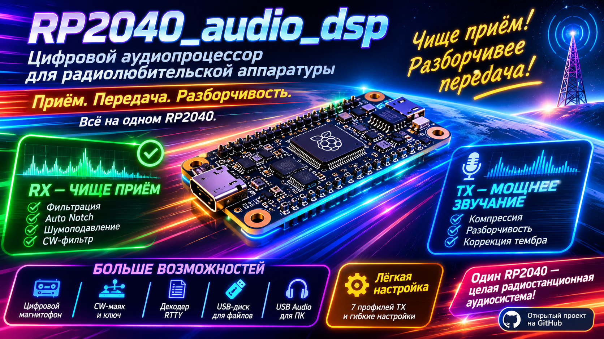
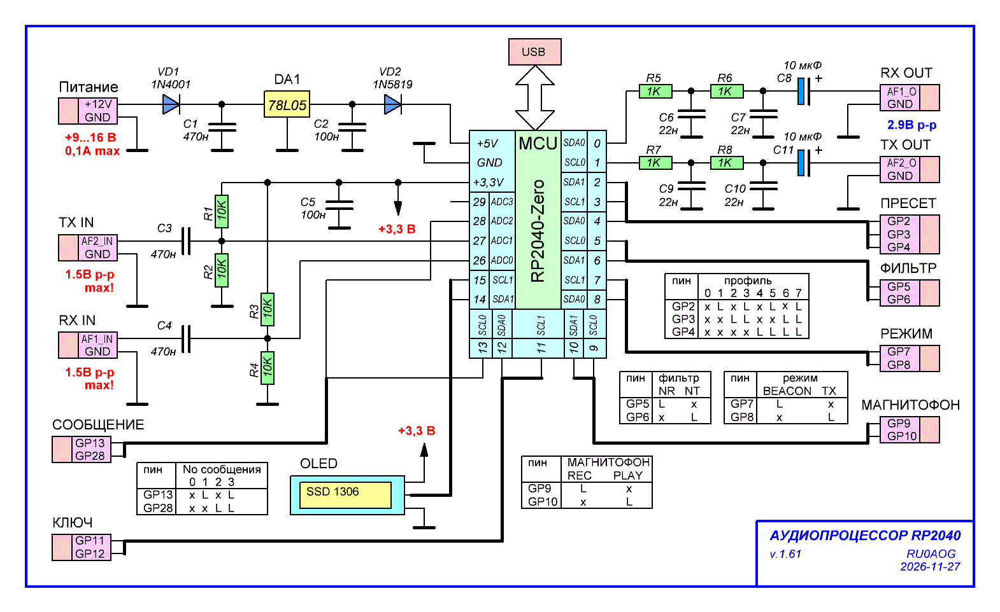

# RP2040_audio_dsp

**Цифровой аудиопроцессор для радиолюбительской аппаратуры на базе RP2040.**

**Чистый приём. Разборчивый SSB. Телеграф и цифровые режимы. Запись и управление через USB.**



RP2040_audio_dsp объединяет приёмный и передающий DSP-тракты, речевой процессор SSB, CW- и RTTY-функции, цифровой магнитофон, USB Audio, виртуальный USB-диск и систему настройки/диагностики. Модуль предназначен для встраивания в самодельные и модернизируемые трансиверы между НЧ-трактом и модулятором/усилителем.

> **Не просто обработка звука. Управление тем, как тебя слышат.**

---

## Содержание

- [Возможности](#возможности)
- [Архитектура](#архитектура)
- [Аппаратная платформа](#аппаратная-платформа)
- [Тракт приёма RX](#тракт-приёма-rx)
- [Тракт передачи TX](#тракт-передачи-tx)
- [CW и RTTY](#cw-и-rtty)
- [Цифровой магнитофон и USB-диск](#цифровой-магнитофон-и-usb-диск)
- [Подключение](#подключение)
- [Управление и CLI](#управление-и-cli)
- [Банки и профили](#банки-и-профили)
- [Диагностика](#диагностика)
- [Сборка](#сборка)
- [Структура проекта](#структура-проекта)
- [Ограничения](#ограничения)
- [Лицензия](#лицензия)

## Возможности

### Один модуль — два аудиотракта

| RX — приём | TX — передача |
|---|---|
| Полосовой FIR | Формирование речевого спектра |
| Автоматический режектор NT | All-pass симметризатор пиков |
| Адаптивное шумоподавление NR | TX-АРУ и шумовой гейт |
| Узкополосный CW-фильтр | Одно- и двухполосная компрессия |
| АРУ и лимитер | Dynamic Presence EQ |
| PWM и USB Audio | Кроссовер и раздельный клиппинг |
| Голосовые подсказки/воспроизведение | HF ducking и intelligibility |
|  | ВЧ-эксайтер и shelf |
|  | Финальный клиппер, постфильтр и DC-блокер |

### Для пользователя

- Настраиваемый приём: полоса, NT, NR, CW-фильтр, АРУ и лимитер.
- Речевой процессор SSB с управлением динамикой и спектральным балансом.
- Семь банков настроек для разных условий работы.
- Семь TX-профилей: `flat`, `natural`, `dx`, `bass`, `whisper`, `loud`, `max`.
- USB Audio для мониторинга и записи на ПК.
- USB-диск с текстовым файлом настроек и WAV-файлами записей.
- Цифровой магнитофон для записи и воспроизведения вызовов.
- CW TX с русской таблицей Морзе, RTTY TX и JTTY TX (4-FSK, WSJT-X 3.3).  
- CW- и RTTY-декодеры с выводом текста в Serial/OLED.  
- Мультимодовый маяк: слоты CW/RTTY/JTTY из CW.TXT, запуск с GP7 или CLI.  
- Электронный ключ: ямбик A/B и прямой ключ на GP11/GP12.  
- GPIO, PTT, Serial CLI и базовый Kenwood-подобный CAT.
- Телеметрия загрузки ядер и состояния аудиоочередей.

[Документация (PDF)](https://github.com/ru0aog/RP2040_audio_dsp/blob/main/doc/RP2040_audio_dsp_GUIDE.pdf) 

---

## Архитектура

RP2040 работает с тактовой частотой **320 МГц**. Задачи распределены между двумя ядрами.

| Узел | Назначение |
|---|---|
| Core 0 | DMA-захват АЦП, вывод PWM и USB, CLI, GPIO, файловый менеджер и диагностика |
| Core 1 | Горячий DSP-путь RX/TX, обработка аудиоблоков в реальном времени |
| Межъядерный обмен | Lock-free SPSC-очереди (`af_queue.h`) |
| DSP-арифметика | Фиксированная точка Q15/Q16/Q24; `int64` для отдельных делений/нормализации |

Горячий DSP-путь не использует `float`. Это позволяет контролировать время обработки и загрузку вычислительного ядра.

### Основные параметры

| Параметр | Значение |
|---|---:|
| Частота RP2040 | 320 МГц |
| Захват ADC | около 495 kS/s |
| Рабочая частота после децимации | 15.464 kS/s |
| Коэффициент децимации | /32 |
| Размер DSP-блока | 64 отсчёта |
| USB Audio | 44.1 кГц, 16 бит |
| Несущая PWM | около 125 кГц |

### Поток данных

```text
Аналоговый вход -> ADC + DMA (Core 0)
                         |
                         v
                   SPSC input queue
                         |
                         v
                   Core 1: DSP RX/TX
                         |
                   SPSC output queues
                         |
               +---------+---------+
               v                   v
            PWM GP0             USB Audio
          RC-фильтр              44.1 кГц
               |                   |
            УНЧ/модулятор          ПК
```

---

## Аппаратная платформа

- RP2040, два ядра Cortex-M0+.
- Тактовая частота проекта — 320 МГц.
- Встроенный 12-разрядный АЦП.
- DMA-захват с аппаратным `chain_to`.
- PWM на GP0/1 с несущей 125 кГц.
- USB Audio Class: UAC-микрофон 44.1 кГц / 16 бит.
- USB Mass Storage Class: виртуальный FAT-диск.
- USB CDC / Serial CLI.
- GPIO для выбора банков, RX-функций, PTT, записи и воспроизведения.
- Поддержка OLED и RGB LED при соответствующем подключении.

---

## Тракт приёма RX

RX выделяет полезный сигнал, подавляет помехи и формирует выход для наушников/УНЧ и компьютера.

### Блок-схема

```text
ADC0 / GP26 — около 495 kS/s  
       |
       v
DMA ping-pong / chain_to
       |
       v
DC-EMA — удаление постоянной составляющей
       |
       v
CIC-децимация + 3 каскада Half-band FIR
       |
       v
15.464 kS/s (суммарная децимация /32)
       |
       v
Полосовой FIR, 127 отводов
       |
       v
CW-фильтр (по включению)
       |
       v
Автоматический режектор NT
       |
       v
Шумоподавление NR
       |
       v
АРУ / ручное усиление + лимитер
       |
       v
Голосовые подсказки / воспроизведение
       |
       +-------------------+
       |                   |
       v                   v
    PWM GP0             USB Audio
       |                 44.1 кГц
    RC-фильтр                |
       |                     v
    УНЧ/наушники              ПК
```

### Стадии RX

1. **ADC и DMA.** ADC1 (GP26) захватывает сигнал с частотой около 495 kS/s. Два DMA-канала с аппаратным `chain_to` обеспечивают непрерывную передачу буферов.
2. **DC-EMA.** Удаление постоянной составляющей и центрирование сигнала.
3. **Децимация.** Каскад CIC и трёх half-band FIR снижает частоту до 15.464 kS/s, суммарный коэффициент — /32.
4. **Полосовой FIR.** 127 отводов; границы полосы задаются пользователем. Типовое значение по умолчанию — 100–3100 Гц.
5. **CW-фильтр.** Узкополосный фильтр с центром 300–3000 Гц, полосой 80–500 Гц и регулируемой примесью фонового шума.
6. **NT.** Адаптивный NLMS-режектор подавляет устойчивые тональные помехи.
7. **NR.** Адаптивный LMS ALE снижает некоррелированную шумовую составляющую.
8. **АРУ и лимитер.** АРУ стабилизирует уровень; при выключенной АРУ используется ручное усиление `gain`, защитный лимитер остаётся активным.
9. **Выходы.** Сигнал разветвляется на PWM GP0/1 и USB Audio Class.

### RX-команды

```text
band <lo> <hi>             Полоса RX FIR, Гц
nt on|off                  Автоматический режектор NT
ntmu <0..32768>            Шаг NLMS нотча (эксперт)
nr on|off                  Шумоподавление NR
nrmu <0..32768>            Шаг LMS NR (эксперт)
nrdepth <q15>              Глубина подавления NR (32768 = полная)
nrmakeup <q15>             Makeup gain NR (65536 = x2)
rxnotch on|off             Узкие нотчи 1/2/3/4 кГц в RX
cw on|off                  Телеграфный фильтр
cw freq <hz>               Центральная частота CW (300..3000)
cw bw <hz>                 Полоса CW (80..500)
cw noise <0..2000>         Примесь шума эфира
cw dec on|off              CW-декодер: текст в Serial  
cw wpm <5..60>             Скорость декодера  
cw sql <0..1>              Сквелч декодера  
nr spec|lms                Движок NR: спектральный | LMS-ALE  
nb on|off / nb thr         Noise blanker импульсных помех  
rx pres on|off             Dynamic Presence EQ RX (подъём ВЧ по SNR)  
rx presmax / rx pres f / rx pres q  
rx shelf / rx shelf f / rx shelf q   Low-shelf «бас»  
rx exc on|off / rx excmix  Гармонический эксайтер  
rxeq on|off, rxeq lo|mid|hi [f]      3-полосный EQ RX  
rx band on|off             Полосовой FIR RX мимо/в тракте  
band2 lo|hi, rx band2 on|off         Пост-фильтр выхода после EQ  
agc on|off                 АРУ (off = ручное усиление)
agcref <1000..32767>       Целевой уровень АРУ
agcmax <1..1000>           Потолок усиления АРУ
agcmin <0.01..1>           Нижний предел усиления АРУ
limceil <1000..32767>      Потолок лимитера
gain <0..8>                Ручное усиление при agc off
bypass on|off              Обход DSP
```

---

## Тракт передачи TX

TX — речевой процессор SSB. Его задача — получить плотный и разборчивый сигнал, управляя пиками, динамикой и спектральным балансом речи.

Передача включается аппаратным PTT на GP8 (`LOW = TX`) или командой `tx on`.

### Блок-схема

```text
Электретный микрофон
       |
       v
Предусилитель на 2N2222
       |
       v
ADC / GP27
       |
       v
Полосовой FIR TX (txband)
       |
       v
All-pass симметризатор пиков
       |
       v
TX-АРУ + шумовой гейт
       |
       v
Двухполосная компрессия
       |
       v
Dynamic Presence EQ
       |
       v
Кроссовер / LR2
       |
       v
Раздельный клиппинг НЧ и ВЧ
       |
       v
ВЧ-эксайтер
       |
       v
Высокочастотная полка (Shelf)
       |
       v
Финальный клиппер (soft / hard)
       |
       v
Постфильтр / подавление гармоник
       |
       v
DC-блокер
       |
       v
Выход TX -> модулятор
```

Состав включённых стадий определяется параметрами TX. Отдельные функции можно отключать для настройки и сравнительных измерений.

### Микрофонный вход

Для электретной капсулы предусмотрен предусилитель на 2N2222.

Ориентировочные параметры:
- питание: 3.3 В;
- коэффициент усиления: около 20;
- коллекторный резистор смещения: 100 кОм;
- резистор коллектора: 1 кОм;
- рабочая точка коллектора: около 1.6 В;
- уровень речи на капсуле: 10–30 мВ;
- ожидаемый уровень на GP27: около 0.2–0.6 В.

Перед настройкой DSP убедитесь, что аналоговый каскад не клиппирует и сигнал находится в допустимом диапазоне ADC.

### Стадии TX

1. **Полосовой FIR.** Ограничивает входной речевой спектр; типовой диапазон — 300–2700 Гц.
2. **All-pass.** Фазовый ротатор изменяет временную форму речевых пиков и помогает эффективнее использовать последующие нелинейные стадии.
3. **TX-АРУ.** Быстро стабилизирует уровень. АРУ ориентирована на усиление и имеет ограничение максимального коэффициента. `txagc 0` выключает TX-АРУ.
4. **Шумовой гейт.** Уменьшает фон в паузах. Нижняя ступень, время удержания и гистерезис регулируются.
5. **Двухполосная компрессия.** Комплементарный кроссовер разделяет НЧ и ВЧ; полосы сжимаются независимо, уменьшая эффект pumping.
6. **Presence EQ.** Динамическая коррекция области присутствия речи с регулируемым максимумом, частотой и добротностью.
7. **Кроссовер LR2 и раздельный клиппинг.** Позволяет управлять НЧ-энергией и ВЧ-деталями раздельно.
8. **HF ducking.** Уменьшает НЧ-составляющую при доминировании ВЧ.
9. **Intelligibility.** Автоматически корректирует баланс НЧ/ВЧ в пределах заданных ограничений.
10. **ВЧ-эксайтер.** Добавляет регулируемую гармоническую составляющую в области речных ВЧ.
11. **Shelf.** Статическая коррекция верхней части речевого спектра.
12. **Финальный клиппер.** Ограничивает пики; доступны soft и hard режимы.
13. **Постфильтр и DC-блокер.** Подавляют продукты нелинейного ограничения и удаляют постоянную составляющую перед выходом на модулятор.

### TX-команды

```text
tx on|off                  Передающий тракт (PTT: GP8 LOW = TX)
txband <lo> <hi>           Речевая полоса TX, Гц
txap on|off                All-pass симметризатор пиков
txagc <0..32767>           Целевой уровень TX-АРУ (0 = off)
txagcmax <x10>             Потолок TX-АРУ (200 = 20x)
txgate <0..32767>          Порог шумового гейта (0 = off)
txgatehold <мс>            Hangover гейта (0..2000)
txgatehyst <x10>           Гистерезис гейта (7 = закрытие по thr*0.7)
txgfloor <0..65536>        Нижняя ступень гейта Q16
tx2band on|off             Двухполосная компрессия TX
txsplit <300..3000>        Частота кроссовера, Гц
txlr2 on|off               Кроссовер LR2 + раздельный клиппинг полос
txcomp <x10>               Компрессия x10: 10=1:1, 20=2:1, 40=4:1
txcompthr <256..32767>     Порог однополосного компрессора
txcompthrlo <256..32767>   Порог НЧ-компрессора
txcompthrhi <256..32767>   Порог ВЧ-компрессора
txduck on|off              HF ducking
txduckmax <дБx10>          Потолок ослабления НЧ (30 = -3 дБ)
txintel on|off             Автобаланс НЧ/ВЧ
txinteltgt <q15>           Цель ratio НЧ/ВЧ (32768 = 1.0)
txintelcut <q15>           Потолок ослабления ВЧ
txintelboost <q15>         Потолок подъёма ВЧ
txpres on|off              Dynamic Presence EQ
txpresmax <дБx10>          Потолок подъёма Presence (30 = +3 дБ)
txpresfreq <500..6000>     Центр Presence-пика, Гц
txpresq <10..500>          Добротность Presence x100
txshelf <дБx10>            Статический подъём ВЧ (0 = off)
txshelffreq <500..6000>    Частота полки
txshelfq <10..500>         Добротность полки x100
txexc on|off               ВЧ-эксайтер
txexcmix <q15>             Подмес эксайтера (3277 = -20 дБ)
txmode soft|hard           Тип клиппера
txclip <0..32767>          Порог финального клиппера
txnotch on|off             Узкие нотчи против тональных наводок
txnotchf <f1> <f2>         Частоты TX-нотчей, Гц (200..7000)
txprof <1..7|имя>          Профиль передачи
txsetdef                   Сброс профиля передачи к дефолтам
```

---

## CW, RTTY и JTTY

### CW TX

- Цифровое формирование телеграфного тона.
- Каскад FIR-фильтров с полосой 700–1400 Гц.
- Типовая частота тона — около 1000 Гц.
- Настраиваемая амплитуда и фронты огибающей.
- Русская таблица Морзе: UTF-8 преобразуется в телеграфные коды.
- Строчные буквы приводятся к верхнему регистру; Ё обрабатывается как Е.
- Исходный кириллический текст может отображаться на OLED, в эфир передаётся соответствующее кодовое представление.

Для проверенной конфигурации CW TX использовался `CWTX_AMP 10000` и фронт `CWTX_RISE_MS 4`. Пользовательские измерения показывают чистый спектр сигнала; при изменении параметров генератора или фильтрации спектр следует проверить повторно.  
  
```text  
cw tx <текст>              Передать текст телеграфом  
cw txwpm <5..60>           Скорость CW, WPM  
cw abort                   Немедленный обрыв посылки  
cw dec on|off              CW-декодер: текст в Serial (при cw on)  
cw wpm <5..60>             Скорость декодера  
cw msg <0..3> [cw|rtty|jtty|null] <текст>   Записать слот маяка  
cw msgs                    Состояние слотов (мода + текст)  
cw clr                     Сброс слотов на дефолты 
cw beacon <5..3600> <текст>|off   Периодический CW-маяк  
vbcn <период_с> on|off     Голосовой маяк (воспроизведение слота)  
```

### RTTY TX

- Формирование mark/space-тонов NCO.
- Полоса выходной фильтрации 700–1400 Гц.
- Два последовательных FIR-каскада по 127 отводов.
- Ограничение амплитуды NCO для предотвращения перегрузки FIR.
- Статус TX показывает фактическую центральную частоту генератора.

В проверенной конфигурации отмечены скаты порядка ±50–60 Гц и подавление вне полосы до приблизительно −120 дБ. Эти значения относятся к конкретной измеренной реализации.

### RTTY-декодер

Исходная документация проекта описывает декодирование RTTY со скоростью 45.45 бод и сдвигом 170 Гц, кодировки Baudot ITA-2 и МТК-2, автопоиск пары тонов и вывод декодированного текста в Serial/OLED. Актуальный набор функций и настроек проверяйте командой `help` текущей прошивки.

### RTTY-команды

```text
rtty on|off                RTTY-декодер 45.45/170  
rtty tx <текст>            Передать текст RTTY (45.45 бод, сдвиг 170 Гц)  
rtty abort                 Обрыв посылки 
rtty rsid|scan on|off      Захват центра по RSID / сканер тонов  
rtty ctr <hz>              Ручной центр mark/space  
rtty dbg on|off            Диагностика # scan:/# trk: в Serial
rtty rev on|off            Инверсия mark/space  
rtty sql <0..1>            Сквелч  
```

### JTTY TX  
  
- 4-FSK, 31.25 бод, кадры 1.888 с (13 sync + 46 данных), центр 1000 Гц.  
- `jtty tx <текст>` — разовая посылка; `jtty abort` — обрыв; `jtty test` — самотест кодека.  
- Декодируется WSJT-X 3.3 (режим JTTY). Только передача.


### JTTY-команды

```text
jtty tx <текст>            Передать JTTY-посылку    
jtty abort                 Обрыв посылки    
jtty test                  Самотест кодека (encode/decode в Serial) 
```

### Маяк  
  
- `mbcn on [0..3]` — слот в его моде из CW.TXT, повтор каждые 3 с; без N — слот с пинов GP13/GP28.  
- `mbcn off` / `mbcn abort` — немедленный обрыв.  
- `cw msg <0..3> [cw|rtty|jtty|null] <текст>` — записать слот; `cw msgs` — показать; `cw clr` — дефолты.  
- `cw beacon <5..3600> <текст>` — CW-маяк произвольного текста; `vbcn` — голосовой маяк.  
- Запуск также с пина GP7 (LOW).  

### CW-ключ  
  
- `GP11` — dit, `GP12` — dah (замыкание на GND).  
- `cw key iambic_a` — ямбик A (память педалей сбрасывается после элемента).  
- `cw key iambic_b` — ямбик B (дополнительный противоположный элемент).  
- `cw key straight` — прямой ключ.  
- `cw key off` — выключен.  
- Скорость общая с `cw txwpm <5..60>`.  

---

## Цифровой магнитофон и USB-диск

Цифровой магнитофон записывает сигнал активного тракта и позволяет воспроизводить его позднее. Записи доступны на виртуальном USB-диске в виде WAV-файлов.

### Основные возможности

- Запись обработанного аудиосигнала.
- Сохранение записей во flash.
- Воспроизведение в RX и TX.
- Использование записи вместо микрофонного сигнала в TX в поддерживаемом режиме.
- Просмотр состояния записей командой `recs`.
- Экспорт записей на ПК через USB MSC.
- Загрузка WAV-файлов с ПК в соответствующие слоты, если это поддерживает текущая сборка.

Четыре слота записи REC1..REC4.WAV, до ~29 с каждый (IMA-ADPCM, 7732 Гц). Слот выбирается селектором GP13/GP28. Поддерживается загрузка произвольного WAV с ПК (PCM 8/16/24/32 бит, mono/stereo — ресемплинг автоматический). Состояние — `recs`.  

### Файлы USB-диска

| Файл | Назначение |
|---|---|
| `SET.TXT` | Текстовая таблица параметров и банков настроек |
| `CW.TXT` | 4 текстовых слота маяка: `N=MODE:TEXT` (N=0..3, MODE=CW/RTTY/JTTY) или `N=NULL` |  
| `REC*.WAV` | Записи вызовов в формате WAV |

### Редактирование настроек через USB

1. Подключите устройство к компьютеру.
2. Откройте появившийся USB-диск.
3. Скопируйте `SET.TXT` в резервную копию.
4. Измените нужные значения, сохраняя формат файла.
5. Запишите файл обратно на диск.
6. Дождитесь завершения обработки записи и обновите окно файлового менеджера.

Файловый парсер применяет поддерживаемые изменения и сохраняет параметры в банках. Не отключайте питание и USB во время записи настроек.

Не форматируйте виртуальный диск и не изменяйте его служебные области. Используйте штатные файлы устройства.

---

## Подключение



### Основные GPIO

| Сигнал | GPIO | Назначение |
|---|---|---|
| Аналоговый вход RX | `GP26` | ADC0, вход НЧ-сигнала |  
| Микрофон TX | `GP27` | ADC1, вход микрофона |  
| PWM RX | `GP0` | Выход приёма через RC-фильтр |  
| PWM TX | `GP1` | Выход передачи (модуляция) через RC-фильтр |  
| Банк, bit 0–2 | `GP2–GP4` | `000` — ручной режим, `001…111` — банки 1…7 |
| NR | `GP5` | Шумоподавление, активный LOW |
| NT | `GP6` | Автонотч, активный LOW |
| Маяк | `GP7` | LOW — маяк: слот GP13/GP28 в его моде (CW.TXT), повтор 3 с |  
| PTT | `GP8` | `LOW` — TX |
| REC | `GP9` | Управление записью |
| PLAY | `GP10` | Управление воспроизведением |
| CW dit/dah | `GP11/GP12` | Телеграфный ключ |
| Выбор сообщения | `GP13`, `GP28` | Биты выбора сообщения/слота |
| OLED SDA/SCL | `GP14/GP15` | I²C OLED |
| RGB LED | `GP16` | WS2812 на RP2040-Zero |

Назначение GPIO может отличаться для разных вариантов платы. Перед монтажом сверяйте конфигурацию с `af_config.h`.

### Аналоговый вход GP27

Вход АЦП должен быть смещён к середине диапазона. Типовое подключение включает:
- последовательный разделительный конденсатор;
- резистивный делитель для установки смещения около Vref/2;
- общую землю источника и платы;
- ограничение амплитуды в допустимом диапазоне ADC.

### PWM-выход GP0

PWM имеет несущую около 125 кГц. Для получения НЧ-сигнала требуется внешний RC-фильтр. Пример начальной конфигурации: R = 1 кОм, C = 10 нФ, частота среза около 16 кГц. Подбирайте фильтр с учётом входного сопротивления следующего каскада.

### Микрофон

Электретная капсула требует смещения и предусилителя. Простой вариант — каскад на 2N2222. До настройки DSP проверьте отсутствие перегрузки аналогового предусилителя и правильный уровень на GP27.

---

## Управление и CLI

Система поддерживает Serial CLI, GPIO, выбор банков, USB-файл настроек и базовый Kenwood-подобный CAT.

Скорость Serial CLI — **115200 бод**. Справка прошивки:

```text
help
?
```

### Системные команды

```text
stats                      Таблица параметров RX/TX/SYS
dump [N|off]               Инженерный дамп счётчиков: разово/каждые N секунд/стоп
save <1..7>                Сохранить настройки в банк
load <0..7>                Применить банк (0 = ручной режим)
banks                      Показать все банки
banks clr                  Восстановить заводские значения банков
pwm on|off                 PWM-выход (off = выход заглушен)
voice [N|vol <0..400>]     Голосовые сообщения и громкость
ramp on|off                Тестовый сигнал вместо DSP
rec                        Начать запись в RAM
play                       Воспроизвести запись/сообщение
stop                       Остановить запись или воспроизведение
recs                       Состояние записей/слотов
jtty tx <текст>            Передать JTTY-посылку  
mbcn on [0..3]|off|abort   Маяк по слотам CW.TXT  
cw msg|msgs|clr            Текстовые слоты маяка  
cw key <mode>              Электронный ключ GP11/GP12  
tt on|off                  Двухтональный генератор (IMD-тест)  
usb reenum                 Переподключение USB (сброс кэша ПК)  
fmap                       Карта flash  
params dump / state dump   Машинные дампы для панели  
help / h / ?               Справка
```

### CAT

В исходной документации указан базовый Kenwood-подобный набор команд с терминатором `;`:

```text
ID; FA; IF; MD; NT; NR; SHxx; SLxx; TX; RX;
```

Поддерживаемый набор зависит от версии прошивки.

---

## Банки и профили

Система предоставляет семь банков настроек. Банк выбирается программно или аппаратным селектором GP2–GP4.

- `load 0` — ручной режим;
- `load 1` … `load 7` — загрузить банк;
- `save 1` … `save 7` — сохранить текущие параметры;
- `banks` — показать содержимое банков;
- `banks clr` — восстановить заводские значения.

### TX-профили

| Номер | Имя | Назначение |
|---:|---|---|
| 1 | `flat` | Нейтральная обработка |
| 2 | `natural` | Естественное звучание |
| 3 | `dx` | Акцент на разборчивости |
| 4 | `bass` | Более выраженная нижняя часть речи |
| 5 | `whisper` | Работа с тихой речью |
| 6 | `loud` | Повышенная плотность |
| 7 | `max` | Максимально интенсивная обработка |

Профиль — отправная точка, а не гарантия одинакового результата с любым микрофоном и модулятором. После выбора профиля проверьте уровень, спектр и разборчивость сигнала.

### Таблица параметров банков

Таблица ниже отражает предоставленный набор вывода `banks`: `cur` — текущие значения, `1…7` — банки.

```text
Параметр          cur      1      2      3      4      5      6      7
RX:
band lo           100    100    300    100    450    300    300    200
band hi          3100   3100   2200   4000    950    900   3000   3500
cw                 off    off    off    off     on    off    off    off
cw f0              700    700    700    700    700    700    700    700
cw bw              150    150    150    150    150    150    150    150
cw noise           400    400    400    400    400    400    400    400
agc                 on     on     on     on     on     on    off     on
gain              1.00   1.00   1.00   1.00   1.00   1.00   1.50   1.00
voice vol          300    300    300    300    300    300    300    300
agc ref           18000  18000  18000  18000  18000  18000  18000  18000
agc max          100.00 100.00 100.00 100.00 100.00 100.00 100.00 100.00
agc min            0.25   0.25   0.25   0.25   0.25   0.25   0.25   0.25
lim ceil           30000  30000  30000  30000  30000  30000  30000  30000
nr depth           24576  24576  24576  24576  24576  24576  24576  24576
nr makeup              0      0      0      0      0      0      0      0
nt mu               2458   2458   2458   2458   2458   2458   2458   2458
nr mu               1638   1638   1638   1638   1638   1638   1638   1638

TX:
tx band lo           300    300    300    300    350    300    300    300
tx band hi          2700   2700   2700   2700   2700   2700   2700   2400
tx comp               40     10     30     60     40     50     40     80
tx clip            26000  32767  20000  12000  26000  16000  24000   6144
tx agc tgt         18000  18000  16000  18000  16000  20000  14000  18000
tx agc max           200    200    200    200    200    200    200    300
tx gate              250      0    250    250    250    150    350    250
tx gate hld          180      0    180    200    180    250    150    180
tx gate hys            7      7      7      7      7      7      7      7
tx gfloor            4120  65535   4120   4120   4120   4120   4120   4120
tx ap                 on    off     on     on     on     on     on     on
tx soft               on     on     on     on     on     on     on     on
tx 2band              on    off     on     on     on     on     on     on
tx split             900    900    900    900    900    900    900    900
tx lr2                on    off     on     on     on     on     on     on
tx cthr              8192   8192   8192   8192   8192   8192   8192   8192
tx cthr lo           8192   8192   8192   8192   8192   8192   8192   6144
tx cthr hi           6144   6144   6144   6144   6144   6144   6144   6144
tx duck               on    off    off     on     on    off     on     on
tx duckmax             30     30     30     30     40     30     30     30
tx intel              on    off     on     on     on     on     on     on
tx intel tgt        15400  15400  15400  15400  15400  15400  15400  15400
tx intel cut        16384  16384  16384  16384  16384  16384  16384  16384
tx intel bst        32768  32768  32768  32768  32768  32768  32768  32768
tx pres               on    off     on     on     on     on     on     on
tx presmax             15      0     15     30     20     30     15     30
tx pres f            2300   1900   1900   1900   1900   1900   1900   1900
tx pres q             100     90     90     90     90     90     90     90
tx shelf               0      0      0     20     10      0      0     40
tx shelf f           1800   1800   1800   1800   1800   1800   1800   1800
tx shelf q             71     70     70     70     70     70     70     70
tx exc                 on    off    off     on    off     on    off     on
tx excmix            3277   3277   3277   3277   3277   1638   3277   3277
tx notch               on    off     on     on     on     on     on     on
tx notch f1          1000   1000   1000   1000   1000   1000   1000   1000
tx notch f2          2000   2000   2000   2000   2000   2000   2000   2000
```

---

## Диагностика

Команда `stats` показывает параметры RX/TX/SYS, загрузку ядер и диагностические счётчики.

Проверяйте:
- загрузку Core 0 и Core 1;
- максимальное время обработки блока;
- потери входных и выходных блоков;
- underrun/overrun очередей;
- состояние включённых алгоритмов;
- USB и файловую подсистему, если эти показатели включены в сборку.

| Счётчик | Значение |
|---|---|
| `cap_dropped` | Потери входных блоков захвата |
| `out_dropped` | Потери выходных блоков |
| underrun | Потребителю не хватило данных |
| overrun | Очередь переполнилась |
| `max_block_us` | Максимальное время обработки блока |

При штатной работе счётчики потерь должны оставаться нулевыми. Если они увеличиваются, проверьте загрузку DSP, параметры алгоритмов, частоту дискретизации и межъядерные очереди.

### Рекомендуемый порядок проверки

1. Проверьте RX с минимальным набором включённых алгоритмов.
2. Убедитесь, что захват и очереди работают без потерь.
3. Включайте NT и NR по одному, контролируя `stats`.
4. Проверьте TX тестовым сигналом и убедитесь, что входной аналоговый каскад не перегружен.
5. Поочерёдно включайте двухполосную компрессию, Presence EQ, intelligibility и эксайтер.
6. Контролируйте выходной спектр на эквиваленте нагрузки или через измерительный тракт.
7. Сохраните проверенные настройки в отдельный банк.

---

## Сборка

Проект использует PlatformIO, Arduino-Pico core от Earle Philhower и TinyUSB. Точные версии зависимостей и параметры сборки определяются `platformio.ini`.

### Сборка

```bash
pio run -e pico
```

### Загрузка

```bash
pio run -e pico -t upload
```

Перед сборкой проверьте выбранную плату, USB-конфигурацию и параметры разгона в `platformio.ini`.

---

## Структура проекта

```text
RP2040_audio_dsp/
├── platformio.ini
├── RP2040_audio_dsp.cpp
├── src/
│   ├── af_config.h       # Частоты, GPIO, параметры DSP и TX
│   ├── af_queue.h        # Lock-free SPSC-очереди
│   ├── af_capture.*      # ADC и DMA-захват
│   ├── af_dsp.*          # RX DSP, децимация, фильтры и АРУ
│   ├── af_tx.*           # TX речевой процессор
│   ├── af_pwm.*          # PWM и выходной поток
│   ├── af_usb.*          # USB Audio и MSC
│   ├── af_fm.*           # USB FAT-диск и обработка файлов
│   ├── af_rec.*          # Цифровой магнитофон
│   ├── af_cli.*          # CLI и CAT
│   ├── af_gpio_ctl.*     # GPIO-управление
│   ├── af_store.*        # Банки настроек во flash
│   ├── af_led.*          # RGB-индикация
│   ├── af_voice.*        # Голосовые сообщения
│   ├── af_snr.*          # Оценка SNR
│   ├── modes/            # CW/RTTY и другие режимы
│   └── voice/            # PCM-ресурсы голосовых сообщений
├── doc/                  # Документация и схемы
└── tools/                # Вспомогательные инструменты
```

Состав файлов может меняться. Для точного соответствия текущей версии ориентируйтесь на дерево исходников репозитория.

---

## Ограничения

- TX-АРУ в описанной конфигурации ориентирована на усиление; снижение уровня выполняют компрессор и клиппер.
- Итоговое качество SSB зависит от микрофона, предусилителя, модулятора, выходного каскада и настройки полосы передатчика.
- Чрезмерная компрессия и клиппинг могут ухудшить спектр и разборчивость. Проверяйте сигнал измерениями.
- Порог гейта следует подбирать под уровень фонового шума и конкретный микрофон.
- Чрезмерный шаг адаптации NT/NR может ухудшать полезный сигнал.
- Flash-операции могут требовать сервисного окна и временно ограничивать доступ к данным. Не отключайте питание во время сохранения.
- Виртуальный USB-диск предназначен для штатных файлов проекта. Не форматируйте его и не изменяйте служебные области.
- Состав команд и диапазоны параметров могут изменяться. Справка текущей прошивки (`help` или `?`) имеет приоритет над документацией.

---

## Лицензия

Проект распространяется на условиях **GNU Affero General Public License v3.0 (AGPL-3.0)**. См. [LICENSE](LICENSE).

Содержит адаптированные алгоритмы из WSJT-X и fldigi (оба под GPL). 

## Автор и проект

- Автор: Станислав RU0AOG
- Репозиторий: https://github.com/ru0aog/RP2040_audio_dsp
- Платформа: RP2040 / Arduino-Pico / PlatformIO

**Слышать больше. Передавать убедительнее.**
